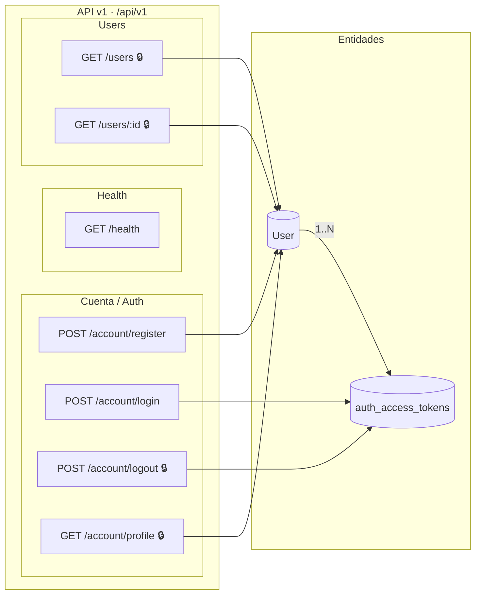
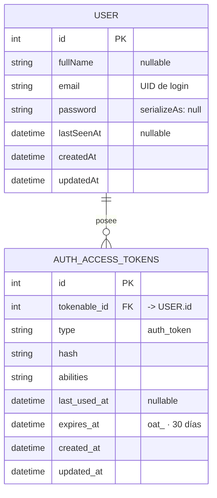

# Arquitectura

Documento vivo que describe la arquitectura del **backend** (AdonisJS 7 + Lucid):
sus entidades de datos, las relaciones entre ellas y los grupos de endpoints REST
expuestos bajo `/api/v1`.

Generado a partir de:

- `backend/app/models/` — modelos Lucid.
- `backend/start/routes.ts` — cableado de rutas.

---

## Entidades

| Entidad | Origen | Campos principales | Notas |
|---|---|---|---|
| **User** | `app/models/user.ts` (modelo Lucid) | `id`, `fullName`, `email`, `password`*, `lastSeenAt`, `createdAt`, `updatedAt` | `password` no se serializa. UID de login: `email`. |
| **auth_access_tokens** | Tabla gestionada por `DbAccessTokensProvider` | `tokenable_id` (→ `User.id`), `hash`, `type`, `expires_at` | Access tokens con prefijo `oat_`, expiran a los 30 días. |

\* `password` está marcado `serializeAs: null` — nunca sale en las respuestas.

**Relación:** un `User` tiene muchos access tokens (1 → N).

---

## Endpoints REST

Todas las rutas de la API cuelgan del prefijo **`/api/v1`**. Las marcadas con 🔒
requieren `middleware.auth()` (Bearer token).

### Health

| Método | Ruta | Controller | Acceso |
|---|---|---|---|
| `GET` | `/health` | `HealthController.index` | Público |

### Cuenta / Autenticación

| Método | Ruta | Controller | Acceso |
|---|---|---|---|
| `POST` | `/account/register` | `NewAccountsController.store` | Público |
| `POST` | `/account/login` | `AccessTokensController.store` | Público |
| `POST` | `/account/logout` | `AccessTokensController.destroy` | 🔒 Protegido |
| `GET` | `/account/profile` | `ProfilesController.show` | 🔒 Protegido |

### Users

| Método | Ruta | Controller | Acceso |
|---|---|---|---|
| `GET` | `/users` | `UsersController.index` | 🔒 Protegido |
| `GET` | `/users/:id` | `UsersController.show` | 🔒 Protegido |

> Fuera de `/api/v1`: `GET /` devuelve el estado de la app (`{ app, status }`).

---

## Diagrama

---

## Diagrama Entidad Relacion

Modelo de datos derivado de `backend/app/models/user.ts`. `User` es el único modelo
Lucid; `AUTH_ACCESS_TOKENS` es la tabla gestionada por `DbAccessTokensProvider`.
Un usuario puede tener cero o muchos access tokens.

---

