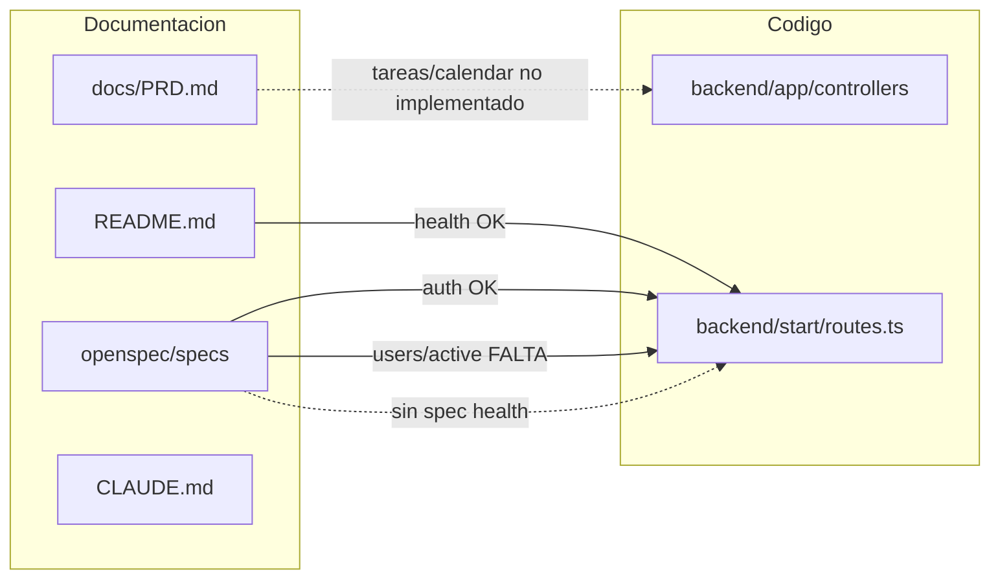

# Auditoría de documentación — FlowSync / full-stack-adonisjs

> Fecha: 2026-07-07 · Repo: `full-stack-adonisjs-s5-base-2606-roo`

## Resumen ejecutivo

El repositorio dispone de documentación **suficiente para arrancar en local** (README raíz con instalación, `.env`, migraciones y servidores de desarrollo). Sin embargo, la documentación de arquitectura, decisiones técnicas, operaciones y trazabilidad OpenSpec↔código presenta **gaps importantes**: no hay ADRs, no hay guía de despliegue ni troubleshooting, y existe al menos una divergencia crítica entre la spec de OpenSpec y el código (`GET /api/v1/users/active` documentado pero no implementado). El PRD describe el producto FlowSync completo (tareas, Google Calendar) mientras el código actual es un starter kit centrado en autenticación y consulta de usuarios.

## Tabla de auditoría

| Tipo de documentación | Estado | Observación | Ubicación |
|---|---|---|---|
| **README de proyecto** | Parcial o pobre | Cubre arranque local (Node 24, `npm install`, `.env`, `generate:key`, migraciones, `npm run dev` en backend y frontend). Falta troubleshooting, tests, build de producción y coherencia de nombres (título y árbol dicen `full-stack-adonisjs-master`; el repo es `s5-base`). Menciona `AGENTS.md` en el árbol pero el archivo no existe. | [`README.md`](../README.md), [`backend/README.md`](../backend/README.md) |
| **Descripción de arquitectura general** | Parcial o pobre | No hay documento de arquitectura del sistema actual. [`docs/PRD.md`](../docs/PRD.md) describe el producto FlowSync (tareas + Google Calendar), no la organización del starter kit. [`backend/README.md`](../backend/README.md) lista carpetas pero no explica relaciones FE↔BE ni flujos de datos. [`docs/README.md`](../docs/README.md) indica que ADRs y diagramas "se añaden en sesiones posteriores". | [`docs/PRD.md`](../docs/PRD.md), [`docs/README.md`](../docs/README.md), [`backend/README.md`](../backend/README.md) |
| **Documentación de API / endpoints** | Parcial o pobre | Tabla de endpoints en README (método, ruta, auth, descripción breve). OpenSpec detalla auth y users con escenarios Given/When/Then. No hay OpenAPI/Swagger, ejemplos curl, esquemas de request/response ni catálogo de errores. `GET /` (raíz) existe en código pero no está documentado. `GET /api/v1/health` está en README y código pero no tiene spec OpenSpec propia. | [`README.md`](../README.md) §Endpoints, [`openspec/specs/authentication/spec.md`](../openspec/specs/authentication/spec.md), [`openspec/specs/users/spec.md`](../openspec/specs/users/spec.md), [`backend/start/routes.ts`](../backend/start/routes.ts) |
| **Docstrings / comentarios (TSDoc/JSDoc)** | Parcial o pobre | Backend: controllers y validators tienen JSDoc mínimo (ruta + una línea). [`UserTransformer`](../backend/app/transformers/user_transformer.ts) está mejor documentado. [`User`](../backend/app/models/user.ts) sin documentación inline. Frontend: cero bloques `/**` en `frontend/src/`. Comentarios útiles pero superficiales para integración sin leer código. | `backend/app/controllers/`, `backend/app/validators/`, `backend/app/transformers/`, `frontend/src/` |
| **Decisiones técnicas (ADRs)** | Inexistente | No existe `docs/adr/`. [`docs/README.md`](../docs/README.md) lo declara pendiente. No hay registro MADR/Nygard de por qué SQLite, access tokens, VineJS, etc. | — (pendiente según [`docs/README.md`](../docs/README.md)) |
| **Guía operacional** | Inexistente | Solo instrucciones de desarrollo local. Sin despliegue (Railway, Docker, CI/CD), runbooks, monitorización ni troubleshooting (p. ej. `APP_KEY` vacío, CORS, migraciones fallidas). | Comandos dispersos en [`README.md`](../README.md) y [`CLAUDE.md`](../CLAUDE.md) |
| **Convenciones de código** | Parcial o pobre | [`CLAUDE.md`](../CLAUDE.md) documenta stack, comandos y convenciones backend (controllers, VineJS, transformers, subpath imports). [`backend/README.md`](../backend/README.md) repite parte. `AGENTS.md` referenciado en CLAUDE y README pero **no existe** en el repo. Sin convenciones frontend (estructura de páginas, servicios, naming). | [`CLAUDE.md`](../CLAUDE.md), [`backend/README.md`](../backend/README.md), [`openspec/config.yaml`](../openspec/config.yaml) |
| **OpenSpec y trazabilidad con código** | Parcial o pobre | Auth alineada spec↔código. **Divergencia crítica:** [`openspec/specs/users/spec.md`](../openspec/specs/users/spec.md) exige `GET /api/v1/users/active` pero no hay ruta ni método `active` en [`backend/start/routes.ts`](../backend/start/routes.ts) ni [`users_controller.ts`](../backend/app/controllers/users_controller.ts). `GET /api/v1/health` en código sin spec. PRD describe MVP FlowSync (CRUD tareas, Google Calendar) muy por encima del código actual (solo auth + users). | [`openspec/specs/`](../openspec/specs/), [`backend/start/routes.ts`](../backend/start/routes.ts), [`docs/NOTAS-FORMADOR.md`](../docs/NOTAS-FORMADOR.md) |

## Diagrama de trazabilidad

## Hallazgos destacados

### 1. Divergencia spec ↔ código (`users/active`)

La spec [`openspec/specs/users/spec.md`](../openspec/specs/users/spec.md) define el requirement **"Listado de usuarios activos"** con tres escenarios para `GET /api/v1/users/active` (usuarios con `last_seen_at` en las últimas 24 h, ordenados descendente). El código **no expone ese endpoint**: [`backend/start/routes.ts`](../backend/start/routes.ts) solo registra `GET /users` y `GET /users/:id`, y [`users_controller.ts`](../backend/app/controllers/users_controller.ts) solo implementa `index` y `show`.

El dato subyacente sí existe (`last_seen_at` en el modelo y migración; el login lo actualiza), lo que hace la divergencia realista y auditable. El README lo menciona explícitamente como pendiente de la Sesión 3.

### 2. PRD vs código implementado

[`docs/PRD.md`](../docs/PRD.md) describe FlowSync como gestor de tareas con sincronización Google Calendar (CRUD tareas, filtros, exportación CSV, OAuth). El código actual implementa únicamente autenticación por access tokens y consulta de usuarios. No hay specs OpenSpec ni código para tareas, calendario ni exportación. El PRD es documentación de producto futuro, no un reflejo del estado actual del repositorio.

### 3. `AGENTS.md` ausente

[`CLAUDE.md`](../CLAUDE.md) indica que en la Sesión 3 se formalizaría `AGENTS.md` enlazado con `ln -s AGENTS.md CLAUDE.md`. El README también lo lista en el árbol del proyecto. El archivo **no existe** en el repositorio; solo está `CLAUDE.md`. Esto puede confundir a copilotos de IA y a desarrolladores nuevos que busquen convenciones en `AGENTS.md`.

### 4. Health sin spec OpenSpec

`GET /api/v1/health` está implementado en [`health_controller.ts`](../backend/app/controllers/health_controller.ts), cableado en rutas y documentado en el README. No existe `openspec/specs/health/spec.md` ni requirement equivalente en las specs actuales. La cobertura OpenSpec es parcial respecto a los endpoints reales.

### 5. Endpoint raíz sin documentar

`GET /` devuelve `{ app: 'full-stack-adonisjs-master', status: 'running' }` según [`backend/start/routes.ts`](../backend/start/routes.ts), pero no aparece en la tabla de endpoints del README ni en OpenSpec.

## Recomendaciones priorizadas

1. **Resolver o documentar la divergencia `users/active`** — Implementar el endpoint según la spec, o marcar el requirement como pendiente/planificado en OpenSpec para que spec y código no contradigan.
2. **Crear `AGENTS.md`** (o symlink a `CLAUDE.md`) y alinear el árbol del README con los archivos reales del repo.
3. **Añadir spec OpenSpec para `health`** y documentar `GET /` si se considera parte del contrato público de la API.
4. **Iniciar `docs/adr/`** con al menos 2–3 ADRs (SQLite, access tokens, monorepo FE/BE) usando plantilla MADR.
5. **Ampliar README** con sección de troubleshooting (errores frecuentes: `APP_KEY`, migraciones, CORS) y comandos de test/build; considerar un `frontend/README.md` con convenciones de la SPA.

---

## Top 3 carencias que más duelen

### 1. Divergencia OpenSpec ↔ código (`GET /api/v1/users/active`)

La spec en [`openspec/specs/users/spec.md`](../openspec/specs/users/spec.md) promete un endpoint que no existe en [`backend/start/routes.ts`](../backend/start/routes.ts). Rompe la confianza en el flujo spec-driven (`/opsx:apply`): un integrador o un agente de IA implementará o probará contra algo que el backend no expone. Es la trampa didáctica más grave y la que más bloquea la trazabilidad.

### 2. PRD desalineado con el código actual

[`docs/PRD.md`](../docs/PRD.md) describe FlowSync completo (tareas, Google Calendar, exportación CSV) pero el repo solo tiene auth + users. Quien use el PRD para planificar backlog, estimar o auditar alcance tomará decisiones sobre funcionalidad inexistente. Riesgo alto de scope creep o historias no implementables.

### 3. Sin ADRs ni guía operacional

No hay `docs/adr/` ni runbooks de despliegue/troubleshooting. Las decisiones (SQLite, access tokens, monorepo) viven solo en código y en [`CLAUDE.md`](../CLAUDE.md); no hay registro de alternativas descartadas ni instrucciones para salir de local. Duele al escalar el equipo, al desplegar o al diagnosticar incidencias sin depender de quien escribió el código.

## Top 3 cosas que ya están bien (no romper en la sesión)

### 1. README de arranque local

[`README.md`](../README.md) guía de punta a punta: Node 24, `npm install`, `.env`, `generate:key`, migraciones y `npm run dev` en backend y frontend. Un dev nuevo puede levantar el proyecto sin preguntar. Es la base operativa del máster; cualquier mejora documental debe complementar, no sustituir ni fragmentar estos pasos.

### 2. OpenSpec de autenticación alineada con el código

[`openspec/specs/authentication/spec.md`](../openspec/specs/authentication/spec.md) describe register/login/logout/profile con escenarios Given/When/Then que coinciden con los controllers reales. Es el modelo de referencia del flujo SDD en este repo; sirve de plantilla para nuevas specs (p. ej. health, users/active) sin tocar la spec de auth que ya funciona.

### 3. Convenciones backend en `CLAUDE.md` + patrones en código

[`CLAUDE.md`](../CLAUDE.md) fija reglas claras (lógica en controllers, VineJS, `UserTransformer`, subpath imports, prefijo `/api/v1`). El código las cumple de forma consistente. Son el contrato tácito entre humanos y copilotos; romperlas (devolver modelos crudos, lógica en routes) introduciría deuda y fugas de `password`. Mantener este patrón al documentar o implementar.

---

## Exploración de 3 formatos de documentación

### 1. diagrama C4
Es de suma importancia el diagrama C4 para entender el contexto, el sistema y sus interacciones externas y su interacción interna.  Esto vendría a reemplazar a lo que personalmente estaba  haciendo de hacer dos diagramas, un diagrama de modelo proceso de negocio BPM lo reemplaza el diagrama de contenido; el diagrama de arquitectura o interacción con otras aplicaciones externas, y lo reemplaza por el diagrama de contexto
### 2. ADR 
Es interesante conocer la decisión de implementación en el código, por que hay cosas que se pueden hacer de diferente forma. Algunas no son obvias y es necesario que algo o alguien explique para seguir las convenciones de esa decisión, de lo contrario, hay un riesgo que el desarrollador rompa la convención porque tiene otro punto de vista.  Muy necesario tener escritas las decisiones en un formato estructurado. 
### 3. especificación OpenAPI Stripe
Tanto el diagrama C4, ADR y API Stripe tienen en común y son mejores que las notas de un markdown porque existe una estructura, una guía formal, ejemplos y documentación de detallada

     