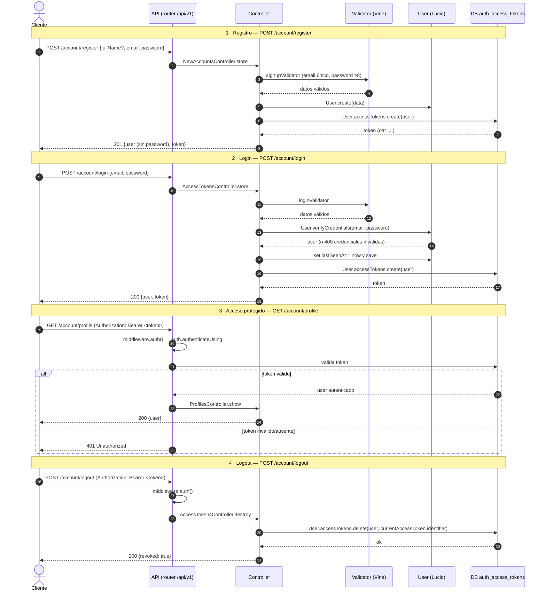

# Flujo de autenticación

Autenticación por **access tokens** (`@adonisjs/auth`, guard `api`). Todas las rutas
cuelgan de `/api/v1`. El token se emite en registro/login y se envía en las rutas
protegidas mediante la cabecera `Authorization: Bearer <token>`.

Derivado de:

- `backend/app/controllers/new_accounts_controller.ts` — registro
- `backend/app/controllers/access_tokens_controller.ts` — login / logout
- `backend/app/controllers/profiles_controller.ts` — ruta protegida
- `backend/app/middleware/auth_middleware.ts` — verificación del Bearer token
- `backend/app/validators/auth.ts` — validación de payloads (VineJS)

---

## Diagrama de secuencia

---

## Notas

- **Formato del token:** `Bearer`, prefijo `oat_`, longitud de secreto 40, **expira a los 30 días** (`User.accessTokens`, `backend/app/models/user.ts`).
- **Salida siempre vía `UserTransformer`** (`backend/app/transformers/user_transformer.ts`): el `password` nunca se devuelve.
- **Rutas protegidas** (`logout`, `profile`, `users`) exigen el header `Authorization: Bearer <token>`; sin él → `401`.
- **Credenciales inválidas** en login → `400` (excepción de `verifyCredentials`).
