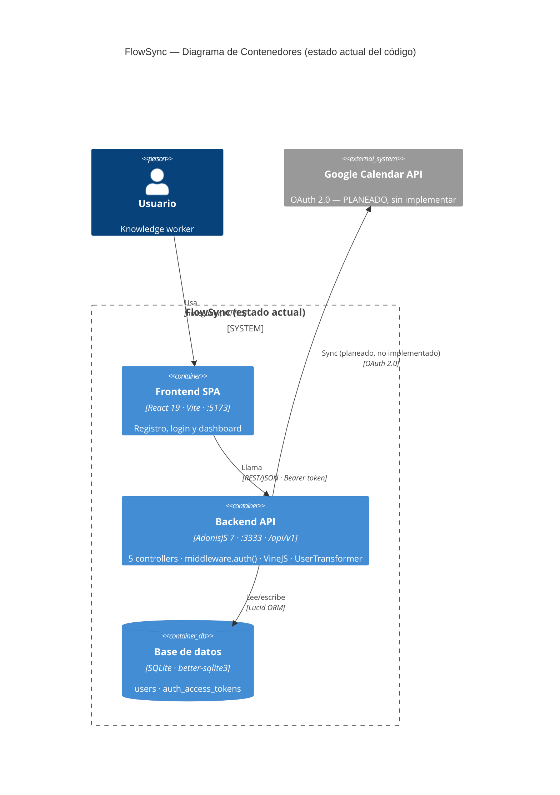

# Entrega S05 — Revisión de backlog y auditoría de documentación

> **Proyecto:** `ai4devs-s04-planificacion-ia-2606-roo` (starter FlowSync, archivos de output, poke-holes).
> **Fecha:** 2026-07-06 · **Autor:** Pako (Juan Francisco Rodríguez Silva)

---

## Parte A — Revisión de backlog

### Ajustes que haría si rehiciera el backlog hoy

1. **Agregar la historia de usuario de sync inicial al conectar con Google Calendar.**
   Al releer los *poke-holes* me percaté de que el usuario real puede conectarse con Google *después* de tener ya tareas y, sin el *backfill*, al conectarse no verá nada anterior: solo lo nuevo que registre tras la conexión. Es más una HDU que hacía falta que un simple detalle.

2. **Definir dependencias y criterios de medición.**
   Aunque mencioné que relacionara las historias, como vimos en la sesión faltó indicar cuáles historias dependían de otras para atacarlas en el orden debido y que no quedaran cabos sueltos. Tampoco puse un criterio de medición (como el de las "camisetas" S, M o L) que permitiera dimensionar cada *feature*.

3. **Sacar el spike técnico del sync como tarjeta propia y colocarlo antes de la HDU12, y separar el ciclo de vida del token (refresh/revocación) de la HDU11.**
   En el directo de S4 entendí que *valor* y *orden de ejecución* son ejes distintos. Como mencioné en el ajuste 2, esto tiene que ver con las dependencias: la HDU12 no es estimable sin resolver zonas horarias, cola/worker e idempotencia. Lo que era una nota al pie debe ser un ítem que bloquee.

4. **Dejar de tratar el DoD como plantilla y ajustarlo por historia.**
   Al no darle bien el contexto del DoD, se copió lo mismo en las 12 historias ("responsive móvil" y "cobertura >90% back y front"), incluida la HDU12, que es casi todo backend/asíncrono y depende de mocks/sandbox de Google. El DoD debe reflejar lo que cada historia realmente entrega.

5. **Cuidar el ejemplo que pasé en el prompt.**
   Como se mencionó en el directo, un ejemplo que no tiene que ver con el proyecto puede desatar confusión en la IA. Asumí que, por ser un ejemplo, no importaba su índole; ahora sé que sí importa, ya que la IA puede tomarlo como algo correcto aunque no tenga relación con el proyecto.

---

## Parte B — Auditoría de documentación

> **Alcance:** documentación del monorepo (backend AdonisJS 7 + frontend React 19 + `openspec/` + `docs/`).

### Paso 4 — Formato del artefacto de auditoría

#### Decisión: tabla en Markdown (tipo · estado · observación · ubicación)

Es el mejor artefacto **consultable** del listado para este caso, por cuatro razones:

1. **Escaneable de un vistazo:** el estado por color/etiqueta y la observación en una línea permiten leer la salud de la doc en 30 segundos, sin narrativa.
2. **Vive junto al código y versiona:** al ser Markdown entra en el repo (Git), se revisa en PR y evoluciona con el proyecto — no es una nota muerta en una herramienta externa.
3. **Estructura fija = cobertura garantizada:** una fila por tipo obliga a cubrir los 8 tipos; ninguno se queda sin estado ni observación.
4. **Coste/beneficio:** un informe por secciones o una matriz visual aportan más prosa/estética pero cuestan más de mantener; un ticket queda atrapado en la herramienta. La tabla da el 90 % del valor con el mínimo esfuerzo.

Uso los otros formatos como **complemento puntual**, no como base: el Top 3 / Top 3 (Paso 6) es un mini-informe por secciones, y para arquitectura recomendaría más adelante un diagrama (matriz visual / C4).

#### Ejemplos de los formatos válidos (para referencia)

**a) Tabla Markdown** (formato elegido):

```markdown
| Tipo de doc | Estado | Observación | Ubicación |
|---|---|---|---|
| README | ✅ Completa | Arranque paso a paso | `README.md` |
```

**b) Informe estructurado por secciones:**

```markdown
## README de proyecto
**Estado:** Completa.
**Observación:** permite arrancar sin preguntar…
**Ubicación:** `README.md`.
```

**c) Matriz visual** (semáforo tipo × dimensión):

```
                Existe   Actualizado   Cumple función
README            🟢          🟢             🟢
API (OpenAPI)     🔴          —              —
ADRs              🔴          —              —
```

**d) Issue / ticket** (cuerpo de la auditoría en tu tracker):

```
Título: [Auditoría S5] Estado de la documentación
Labels: docs, audit
Cuerpo: <la tabla de abajo> + checklist de acciones
```

---

### Paso 5 — Auditoría por tipo de documentación

| # | Tipo de documentación | Estado | Observación | Ubicación |
|---|---|---|---|---|
| 1 | **README de proyecto** | ✅ Completa | Arranque real desde cero: requisitos (Node 24), `npm install`, `cp .env.example .env`, `generate:key`, `migration:run`, `npm run dev` para backend **y** frontend. Un dev nuevo levanta el proyecto sin preguntar. Único hueco menor: **el frontend no tiene README propio** (todo cuelga del raíz) y el README anuncia "ADRs y diagramas" en `docs/` que aún no existen. | `README.md` |
| 2 | **Arquitectura general** | ⚠️ Parcial / pobre | Hay descripción **dispersa**: árbol del monorepo en `README.md`, stack + capas en `CLAUDE.md`, y `context` en `openspec/config.yaml`. **No hay documento único de arquitectura ni diagrama** (de componentes/relaciones/flujo). El PRD menciona un "diagrama C4" que no está creado. Se entiende el sistema leyendo tres sitios, no uno. | `README.md`, `CLAUDE.md`, `openspec/config.yaml` |
| 3 | **API / endpoints** | ⚠️ Parcial | Tabla de endpoints en `README.md` + contratos detallados en las specs de OpenSpec (request/response y códigos HTTP). **Pero no hay OpenAPI/Swagger ni colección Postman**: no existe contrato formal consumible por herramientas (generar cliente, mock, validar). Además la doc de API **lista un endpoint que no existe** (ver fila 8). Un integrador se orienta, pero sin garantía de exactitud. | `README.md`, `openspec/specs/*/spec.md` |
| 4 | **Docstrings / comentarios (TSDoc/JSDoc)** | ⚠️ Parcial | Los controllers, el `UserTransformer` y los validators VineJS tienen JSDoc **breve** (método + ruta + auth), útil y no genérico. Pero es mínimo: **no documenta parámetros, errores lanzados ni tipo de retorno**, y el modelo `User` no tiene docstring. Nivel starter correcto, no exhaustivo. | `backend/app/controllers/*.ts`, `backend/app/transformers/user_transformer.ts`, `backend/app/validators/auth.ts` |
| 5 | **Decisiones técnicas (ADRs)** | ❌ Inexistente | **No existe ningún ADR** ni carpeta `docs/adr/`. `README.md` y `docs/README.md` prometen "ADRs… en sesiones posteriores", pero hoy no hay ninguno. Decisiones de peso (access tokens vs. sesión, SQLite, transformer obligatorio, prefijo `/api/v1`) solo viven implícitas en `CLAUDE.md`: se sabe **qué** se decidió, no **por qué** ni **qué se descartó**. | — (esperado en `docs/adr/`) |
| 6 | **Guía operacional (deploy / runbook / troubleshooting)** | ❌ Inexistente | **Nada de operación.** No hay `Dockerfile`, `docker-compose`, workflows de CI/CD (`.github/workflows` no existe), ni runbook/troubleshooting/deploy. Solo comandos de **desarrollo local**. Cero información sobre producción, backups, variables de entorno de prod o gestión de incidencias. | — |
| 7 | **Convenciones de código** | ✅ Completa | `CLAUDE.md` documenta naming, estructura (lógica en controllers, no en `routes.ts`), validación con VineJS, serialización obligatoria vía transformer, subpath imports (`#controllers/*`), prefijo `/api/v1`, `middleware.auth()` y una sección explícita **"No hacer"**. `openspec/config.yaml` repite el resumen. Coherente con el código real. *(Nota: `CLAUDE.md` dice que se formalizará como `AGENTS.md` vía symlink, pero ese `AGENTS.md` aún no existe en el repo.)* | `CLAUDE.md`, `openspec/config.yaml` |
| 8 | **OpenSpec ↔ trazabilidad con el código** | ⚠️ Parcial (**divergencia detectada**) | `authentication/spec.md`: 4 requirements (register, login, logout, profile) → **todos implementados** ✅. `users/spec.md`: 3 requirements, pero el 3.º **"Listado de usuarios activos" (`GET /api/v1/users/active`) NO existe en el código**: `users_controller.ts` solo tiene `index` y `show`, y `routes.ts` no registra la ruta (solo hay un comentario "se implementa en vivo en S3"). El dato `last_seen_at` **sí** existe (modelo + login lo actualiza) → la divergencia es sutil: *el dato está, el endpoint no*. **La spec promete una capability que el backend no expone.** | `openspec/specs/users/spec.md:51` vs `backend/app/controllers/users_controller.ts`, `backend/start/routes.ts` |

#### Tipos adicionales detectados

| # | Tipo | Estado | Observación | Ubicación |
|---|---|---|---|---|
| E1 | **Documentación de producto (PRD)** | ✅ Completa como doc / ⚠️ desalineada con el código | El PRD de FlowSync es completo y de buena calidad (visión, usuario, RF/RNF, criterios de éxito, riesgos, glosario). **Pero describe un MVP** (CRUD de tareas, filtrado, export CSV, sync con Google Calendar) del que **el backend no implementa nada aún**: hoy solo hay auth + users. Es esperable en un starter/hilo conductor, pero conviene marcar que **el PRD va muy por delante del código**. | `docs/PRD.md`, `docs/README.md` |
| E2 | **Memoria para agentes de IA** | ✅ Completa | `CLAUDE.md` + `openspec/config.yaml` + skills `.claude/` y `.cursor/` dan contexto sólido a copilotos (stack, convenciones, flujo `/opsx:*`). Punto fuerte del repo, poco común. | `CLAUDE.md`, `.claude/`, `.cursor/` |

> **No aplica:** documentación de librería/SDK público (el proyecto es una app, no una librería consumible por terceros) y documentación de esquema de BD como tal (el esquema vive en las migraciones de Lucid, autodocumentado por el ORM).

---

### Paso 6 — Cierre de la auditoría

#### 🔴 Top 3 carencias que más duelen

1. **Divergencia spec ↔ código: `GET /api/v1/users/active` documentado pero inexistente.** La spec de `users` (fuente de verdad "doc viva") promete un endpoint que el backend no expone; y a mayor escala, el PRD entero describe funcionalidad (tareas, sync Google) que no está en el código. **Duele porque quien confía en la documentación se equivoca**: un integrador o un agente de IA implementaría contra un contrato falso. *(Es la trampa didáctica del ejercicio — no se corrige, se reporta.)*
2. **Guía operacional inexistente.** No hay forma documentada de desplegar, ni runbook de incidencias, ni troubleshooting, ni CI/CD. **Duele el día que esto tiene que salir a producción o falla algo**: el conocimiento operativo no existe, solo el arranque local.
3. **Cero ADRs → el "por qué" no está escrito.** Access tokens vs. sesión, SQLite en vez de Postgres, transformer obligatorio… se sabe qué se hizo pero no por qué ni qué alternativas se descartaron. **Duele en el mantenimiento**: cada decisión se re-litiga desde cero y se pierde el contexto histórico. (Relacionado: la API tampoco tiene contrato formal OpenAPI.)

#### 🟢 Top 3 cosas que ya están bien (no romper en el directo)

1. **README de arranque impecable.** Un dev nuevo levanta backend **y** frontend desde cero sin preguntar (deps, `.env`, key, migraciones, servidor). No tocar el flujo de onboarding.
2. **Convenciones de código explícitas y respetadas.** `CLAUDE.md` describe patrones (controllers, VineJS, transformer, subpath imports, "No hacer") que el código real cumple al pie de la letra. Base sólida y coherente.
3. **Specs de OpenSpec con contratos claros.** `authentication` y `users` documentan requirements + scenarios con códigos HTTP; la parte de auth está 100 % alineada con el código. Es buena doc viva — hay que corregir la divergencia de `/users/active`, no rehacer las specs.

---

### Paso 7 — Vocabulario básico: qué aporta cada formato (una línea)

- **Diagrama C4** (`c4model.com`): da una **vista visual y jerárquica** (Contexto → Contenedores → Componentes) de qué habla con qué; de un vistazo ves los límites del sistema y las relaciones entre piezas — algo que un párrafo de notas sueltas no comunica.
- **ADR** (repo `joelparkerhenderson/architecture-decision-record`): captura el **porqué de una decisión y las alternativas descartadas**, con fecha y estado; unas notas dicen *qué* se hizo, un ADR dice *por qué* y *qué se rechazó*, y queda como registro inmutable.
- **Especificación OpenAPI** (GitHub/Stripe): es un **contrato formal machine-readable** de la API (rutas, params, schemas, códigos) que genera clientes/mocks/UI (Swagger) y se puede **validar automáticamente contra el código** — unas notas en Markdown no son ejecutables ni verificables.

---

## Anexo — Diagrama C4 (nivel Contenedor)

> Diagrama del **estado actual del código** (auth + users), **no** de la visión del PRD.
> Google Calendar aparece como **planeado / no implementado** (línea discontinua) — es justo la brecha PRD↔código de la fila E1.

### Vista (ASCII)

```
                        ┌──────────────────────┐
                        │       Usuario        │
                        │   knowledge worker   │
                        └──────────┬───────────┘
                                   │ usa (navegador, HTTPS)
   ┌───────────────────────────────▼──────────────────────────────┐
   │  Sistema: FlowSync — estado actual del código                │
   │                                                              │
   │              ┌──────────────────────────┐                    │
   │              │      Frontend SPA         │                   │
   │              │  React 19 · Vite · :5173  │                   │
   │              └────────────┬─────────────┘                    │
   │                           │ REST/JSON · Bearer token         │
   │              ┌────────────▼─────────────┐    sync             ┌─────────────┐
   │              │       Backend API         │ ─ ─ ─ ─ ─ ─ ─ ─ ─▶│   Google    │
   │              │ AdonisJS 7 · :3333        │  (no implementado) │ Calendar API│
   │              │ /api/v1 · 5 controllers   │                    │ OAuth2 ·ext │
   │              │ VineJS · UserTransformer  │                    └─────────────┘
   │              └────────────┬─────────────┘        (planeado)
   │                           │ lee/escribe · Lucid ORM
   │              ┌────────────▼─────────────┐
   │              │      Base de datos        │
   │              │ SQLite · better-sqlite3   │
   │              │ users · auth_access_tokens│
   │              └──────────────────────────┘
   └───────────────────────────────────────────────────────────────┘

   ─ ─ ─  línea discontinua = planeado en el PRD, aún sin código
```

### Equivalente Mermaid (`C4Container`) — renderizable en GitHub/soportes compatibles



> **Lectura del diagrama para el directo:** el sistema real hoy son **3 contenedores** (SPA → API → SQLite). Todo lo demás del PRD (tareas, filtrado, export CSV, sync) todavía no tiene contenedor ni componente que lo soporte. El nivel Componente (L3) del Backend sería el siguiente paso: `NewAccounts/AccessTokens/Profiles/Users/Health controllers` → `auth_middleware` → `VineJS validators` → `UserTransformer` → `User model`.

### Comentario

- Me apoye en Claoude Code para la realizacion de este archivo asi como para la auditoria del repo, quize dejar como apoyo visual lso digramas ya que para mi en lo personal sirven mejor para mi aprendeizaje.
