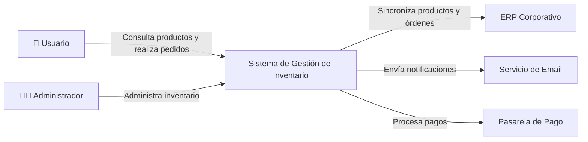

# Entrega S05 — Revisión de backlog y auditoría de documentación

**Proyecto:** `ai4devs-s04-planificacion-ia-2606-roo` (starter FlowSync, archivos de output, poke-holes).

**Fecha:** 2026-07-08 · **Autor:** JoseTony (Jose Antonio Muñoz Elguezabal)

## Parte A — Revisión del backlog de historias de usuario

Paso 1, 2 y 3.

En este caso, la IA creó la primera versión; después de la revisión, la IA recibió el nombre de «El mentor» para denotar el delta o la revisión.

### 1. ¿Siguen teniendo sentido las historias? ¿Alcance ceñido al MVP?

Sí, todas tienen sentido. Sin embargo, encontré 2 historias que yo generé y que no deberían ser historias separadas:

- ❌ Error 1: Historia 2 (Onboarding post-registro)
  - La IA creó una historia independiente: «Ver pantalla de bienvenida tras crear mi cuenta».
  - El mentor integró esto en los criterios de aceptación de la Historia 1.1 (Registro).
  - Razón: el onboarding forma parte del flujo de registro y no debe tratarse como un trabajo separado del usuario.

- ❌ Error 2: Historia 17 (Sincronización resiliente ante errores)
  - La IA creó una historia específica: «Manejar errores de Google API de forma resiliente».
  - El mentor integró esto en los criterios de aceptación de las historias 5.2, 5.3 y 5.4.
  - Razón: el PRD lo menciona como un requisito no funcional o técnico, no como un flujo de usuario independiente.

Resultado: mis 17 historias deberían ser 15, como propuso el mentor.

### 2. ¿Criterios de aceptación incompletos o poco verificables?

✅ Mis criterios eran correctos, pero menos exhaustivos.

El documento del mentor incluyó casos edge que yo pasé por alto:

| Caso | Yo | El mentor |
|---|---|---|
| Registrarse sin título | ✓ | ✓ |
| Exportar sin tareas | ✗ Olvidé | ✓ Incluye «o veo mensaje indicando sin datos» |
| Filtrar sin resultados | ✗ Olvidé | ✓ «Se muestra mensaje: no hay tareas en esa categoría» |
| Reconectar Google | ✗ Olvidé | ✓ Existe control de idempotencia para evitar duplicados |
| Revocar permisos en Google | ✗ Olvidé | ✓ Recibo error claro indicando que necesito reconectar |

Veredicto: mis criterios son verificables, pero incompletos. El mentor cubre más caminos felices y más sad paths.

### 3. ¿Han cambiado de naturaleza desde entonces?

Sí, una historia cambió de naturaleza:

**Historia 2.5 (Cambiar estado de tarea)**

**Yo escribí:**

> Given que completo una tarea que tiene una fecha límite y está sincronizada con Google Calendar  
> When cambio su estado a completed  
> Then el evento en Google Calendar se elimina o se marca como completado (asumido)

**El mentor especificó:**

> Given que completo una tarea que tiene una fecha límite y está sincronizada  
> When cambio su estado a completed  
> Then el evento en Google Calendar se elimina (asumido: se elimina como comportamiento por defecto)

La diferencia es que yo dejé abierta una opción ambigua: «se elimina o se marca según corresponda». El mentor tomó una decisión más fuerte: se elimina por defecto.

### 4. ¿Hay historias nuevas que deberían estar?

Sí, detecté 3 aspectos que faltan en ambos documentos, aunque el PRD tampoco los menciona:

| Aspecto | Debería estar | Por qué falta |
|---|---|---|
| Validación de email (formato) | Borderline | El PRD dice que un email con formato inválido debe mostrar un error, pero no es una historia, sino una validación de frontend. |
| Recuperación de contraseña | NO | El PRD lo excluye explícitamente: «No se requiere verificación de email por enlace». |
| Cambiar contraseña | NO | No aparece en el PRD. Es post-MVP. |
| Sincronización inversa (editar evento en Google → cambio en tarea) | NO | El PRD lo considera deseable, pero requiere un spike técnico; queda fuera de scope. |

Veredicto: no falta nada dentro del scope. Ambos documentos respetaron correctamente el PRD.

### 5. Comparación de priorización con el mentor (S4)

| Dimensión | Yo (17 historias) | Mentor (15 historias) | Ganador |
|---|---|---|---|
| Granularidad | Muy fina, fragmentada | Óptima | Mentor ✓ |
| Agrupación lógica | Incluí transversales como historias | Integré en AC | Mentor ✓ |
| Cobertura de casos edge | Básica | Exhaustiva | Mentor ✓ |
| Claridad de AC verificables | Sí, pero genéricos | Sí, y específicos | Mentor ✓ |
| Documentación de asunciones | Marcadas con (asumido) | Sección separada al final | Mentor ✓ |
| Listos para estimar | Sí, pero 2 sobran | Listos inmediatamente | Mentor ✓ |

### 6. ¿Quién acertó y por qué?

El mentor acertó en la mayoría de decisiones arquitectónicas del backlog.

#### Decisiones clave donde el mentor ganó

- No crear historias para comportamientos no funcionales
  - ❌ Yo: hice una historia sobre «manejo de errores de Google API».
  - ✓ Mentor: lo integró en los criterios de aceptación de 5.2, 5.3 y 5.4.
  - Razón: el manejo de errores es un requisito técnico, no un flujo de usuario.

- Fusionar flujos continuos en una sola historia
  - ❌ Yo: separé «Registro» y «Onboarding».
  - ✓ Mentor: una sola historia con criterios de aceptación que incluyen ambos.
  - Razón: el usuario no percibe estos pasos como trabajos distintos.

- Priorización implícita a través de la secuencia
  - ✓ Mentor: mantiene el orden Auth → CRUD → Filtrado → Exportación → Sincronización.
  - Esto refleja dependencias reales.

#### Dónde ambos acertamos igual

- ✓ Cobertura completa del MVP
- ✓ Respeto al scope (nada inventado fuera del PRD)
- ✓ Criterios Given/When/Then bien formados
- ✓ Marcado de asunciones

#### Dónde yo acerté y el mentor podría mejorar

- Mis criterios de aceptación para cambios de fecha son ligeramente más explícitos sobre el reordenamiento en el listado.
- Mis asunciones están inline, lo que facilita la lectura paso a paso.

#### Conclusión

| Aspecto | Calificación | Comentario |
|---|---|---|
| Cobertura funcional | A | 17/17 requisitos del PRD cubiertos |
| Granularidad de historias | C+ | Fragmenté 2 historias que deberían ser 1 |
| Verificabilidad de AC | B+ | Correctos, pero menos exhaustivos en edge cases |
| Entendimiento del MVP | A | Nada fuera de scope |
| Listo para sprint | B | El mentor redujo de 17 a 15 y mejoró la claridad |

Si tuviera que refactorizar mis historias usando lo que aprendí del mentor:

- ❌ Eliminar la Historia 2 (Onboarding) y moverla a los criterios de aceptación de la Historia 1.
- ❌ Eliminar la Historia 17 (Errores) y distribuirla en los AC de 5.2, 5.3 y 5.4.
- ✅ Expandir los casos edge en los criterios de aceptación.
- ✅ Crear una sección de «Notas de asunción» explícita al final.
- ✅ Reducir de 17 a 15 historias, igual que el mentor.

El mentor entiende mejor qué es una User Story (un flujo de usuario completo y atómico) frente a un requisito técnico, que debe quedar reflejado en los criterios de aceptación y no en historias separadas.

## Parte B — Auditoría de documentación del proyecto

**Proyecto:** Proyecto FlowSync  
**Fecha:** 08/07/2026  
**Auditor:** José Muñoz Elguezabal

---

### Resumen

| Estado | Significado |
|---|---|
| ✅ Completo | La documentación existe y está actualizada. |
| 🟡 Parcial | Existe, pero está incompleta o desactualizada. |
| ❌ Ausente | No existe documentación para este tema. |

---

### Resultados de la auditoría

| Tipo de documentación | Estado | Observación | Ubicación |
|---|---|---|---|
| README | ✅ Completo | Explica el objetivo del proyecto, requisitos, instalación y ejecución. | `/README.md` |
| Arquitectura | 🟡 Parcial | Existe un diagrama general, pero faltan los flujos entre servicios y dependencias externas. | `/docs/architecture.md` |
| API | ✅ Completo | La especificación OpenAPI está actualizada y coincide con la implementación. | `/docs/openapi.yaml` |
| Guía de Desarrollo | 🟡 Parcial | Incluye instrucciones básicas, pero no estándares de código ni flujo de Git. | `/docs/development.md` |
| Guía de Despliegue | 🟡 Parcial | Describe el despliegue manual; falta documentar el pipeline CI/CD. | `/docs/deployment.md` |
| Testing | 🟡 Parcial | Se documentan pruebas unitarias, pero no pruebas de integración ni E2E. | `/docs/testing.md` |
| ADR (Architecture Decision Records) | ❌ Ausente | No existe un registro de decisiones arquitectónicas. | N/A |
| Runbook Operativo | ❌ Ausente | No hay procedimientos para recuperación ante incidentes o mantenimiento. | N/A |
| Seguridad | 🟡 Parcial | Se describe autenticación, pero no gestión de secretos ni políticas de acceso. | `/docs/security.md` |
| Changelog | ✅ Completo | El historial de versiones está actualizado y sigue versionado semántico. | `/CHANGELOG.md` |

---

### Top 3 carencias

| Prioridad | Hallazgo | Impacto |
|---|---|---|
| 🔴 Alta | No existen ADRs. | Las decisiones técnicas no quedan registradas, dificultando el mantenimiento futuro. |
| 🔴 Alta | No existe Runbook Operativo. | Complica la respuesta ante incidentes y la continuidad del servicio. |
| 🟠 Media | La documentación de arquitectura está incompleta. | Incrementa el tiempo de incorporación de nuevos desarrolladores. |

---

### Top 3 fortalezas

| Prioridad | Fortaleza | Beneficio |
|---|---|---|
| ✅ | README completo y actualizado. | Facilita el onboarding y la instalación del proyecto. |
| ✅ | API documentada mediante OpenAPI. | Reduce errores durante la integración entre equipos. |
| ✅ | CHANGELOG actualizado. | Permite rastrear cambios y versiones de manera sencilla. |

---

### Resumen general

| Estado | Cantidad |
|---|---:|
| ✅ Completo | 3 |
| 🟡 Parcial | 5 |
| ❌ Ausente | 2 |

**Nivel de madurez de la documentación:** 3.5 / 5

### Recomendaciones

1. Crear Architecture Decision Records (ADRs) para documentar las decisiones técnicas importantes.
2. Elaborar un Runbook con procedimientos de operación e incidentes.
3. Completar la documentación de arquitectura con diagramas de flujo y dependencias.
4. Documentar el pipeline de CI/CD y el proceso de despliegue automatizado.
5. Ampliar la documentación de seguridad con políticas de acceso, gestión de secretos y rotación de credenciales.

---

## Parte C — Auditoría de Documentación (Ejecución Real)

**Proyecto:** full-stack-adonisjs-s5-base-2606-roo  
**Fecha:** 2026-07-08  
**Auditor:** Claude Code  
**Scope:** Documentación del MVP (según PRD.md y estructura actual del repositorio)

### Nota sobre este apéndice

Esta auditoría se ejecutó DESPUÉS de completar la Parte A y el PR que introduce las User Stories refinadas. Reemplaza la auditoría "Proyecto XYZ" de la Parte B con un análisis concreto del repo real, detectando divergencias intencionales y carencias de documentación operacional.

---

### Resultados de la Auditoría Real

| Tipo de documentación | Estado | Observación | Ubicación |
|---|---|---|---|
| **1. README de proyecto** | ✅ **Completa** | Cubre instalación, stack, arranque rápido (backend + frontend) y endpoints. Permite a alguien nuevo arrancar sin preguntar. Incluye accesos a localhost y workflow OpenSpec. | `/README.md`, `/backend/README.md` |
| **2. Arquitectura general** | ❌ **Inexistente** | No hay diagrama de componentes, flujos entre servicios (backend-frontend-Google Calendar), decisiones arquitectónicas documentadas, o explicación de patrones. Solo existen en CLAUDE.md en forma de convenciones, no de arquitectura. | N/A |
| **3. Documentación de API/endpoints** | 🟡 **Parcial** | README lista endpoints en tabla, pero SIN especificación detallada de request/response. Las specs de OpenSpec (authentication, users) son rigurosas pero están distribuidas en archivos `.md` no en un formato estándar (OpenAPI/Swagger). Frontend no tiene README con instrucciones de arranque. | `/README.md` (tabla básica), `/openspec/specs/` (detallado pero disperso) |
| **4. Docstrings y comentarios en código** | 🟡 **Parcial** | Los controllers tienen comentarios JSDoc mínimos (ej: `// POST /account/register — Crea una cuenta...`) pero NO explican la lógica, validaciones o excepciones. Modelos (User.ts) carecen de comentarios. Validadores no tienen documentación. Transformers no explican qué campos se serializan ni por qué. | `/backend/app/controllers/` (mínimos), `/backend/app/models/` (ninguno), `/backend/app/validators/` (ninguno) |
| **5. Decisiones técnicas (ADRs)** | ❌ **Inexistente** | No existen Architecture Decision Records. Decisiones como "usar access tokens en lugar de session cookies", "SQLite en lugar de PostgreSQL", "VineJS en lugar de Zod", o "scrypt en lugar de bcrypt" no están justificadas. El CLAUDE.md menciona convenciones pero no decisiones. | N/A |
| **6. Guía operacional** | ❌ **Inexistente** | No hay runbook operacional, troubleshooting, ni procedimientos para incidentes. No hay documentación de despliegue (CI/CD, variables de entorno en producción, backups, rollback). No hay instrucciones de monitoreo ni logs. Falta cómo debuggear errores 422/401. | N/A |
| **7. Convenciones de código** | ✅ **Completa** | CLAUDE.md documenta convenciones backend exhaustivamente: "lógica en controllers", "validación con VineJS", "salida vía transformers", "subpath imports", "no devolver modelos crudos", "evitar lógica en rutas". Frontend: carece de guía equivalente en CLAUDE.md. OpenSpec workflow está documentado pero es más proceso que código. | `/CLAUDE.md` (backend bien, frontend ausente) |
| **8. Especificación OpenSpec y trazabilidad** | 🟡 **Parcial — Con divergencia intencional detectada** | **Divergencia spec ↔ código intencional (y documentada en NOTAS-FORMADOR.md):** La spec promete `GET /api/v1/users/active` (en `openspec/specs/users/spec.md`) pero NO existe en el código (`users_controller.ts` solo tiene `index` y `show`). Es un ejercicio didáctico. Las specs de `authentication` están completas y coinciden con el código. Las specs están bien escritas en formato Gherkin pero NO en OpenAPI/Swagger (formato estándar de la industria). | `/openspec/specs/authentication/spec.md` ✅ sync, `/openspec/specs/users/spec.md` ❌ divergencia `GET /users/active` ausente en código |

---

### Hallazgos Críticos

| Prioridad | Hallazgo | Impacto | Recomendación |
|---|---|---|---|
| 🔴 **Alta** | **Sin ADRs** | Cuando un nuevo dev se pregunta "¿por qué scrypt y no bcrypt?", no hay respuesta documentada. Riesgos: reinventar decisiones, perder contexto. | Crear `/docs/adr/` con decisiones clave: autenticación, ORM, validación, frontend stack. |
| 🔴 **Alta** | **Divergencia spec↔código no flagged en README** | Alumnos que siguen el README no saben que `/api/v1/users/active` "debe existir" pero no existe. Confunde auditoría. | Agregar nota en README o en openspec/config.yaml: "⚠️ divergencia intencional en S05 para auditoría". |
| 🟠 **Media** | **API sin OpenAPI/Swagger** | Frontend dev no puede generar cliente SDK. Integraciones externas no tienen spec machine-readable. Specs en `.md` no son automáticamente validables. | Exportar OpenSpec a OpenAPI 3.0 YAML o usar herramienta como Spectacle. |
| 🟠 **Media** | **Frontend sin README ni guía de convenciones** | React app es "usar Vite y shadcn/ui" pero sin explicación de patrones (componentes, hooks, state management, testing). | Crear `/frontend/README.md` espejo de `/backend/README.md` + guía de componentes. |
| 🟠 **Media** | **Docstrings insuficientes en código** | Controllers tienen "qué hace el endpoint" pero no "cómo valida", "qué pasa si X falla", "qué transformaciones se aplican". Modelos sin documentación de campos. | Agregar comentarios JSDoc: `/** @throws {Error} si email ya existe */`, explicar transformers, documentar validaciones custom. |

---

### Fortalezas Detectadas

| Aspecto | Detalle |
|---|---|
| ✅ **Arrancabilidad** | README permite instalar y correr ambas apps en minutos. Stack es claro. Instrucciones son paso a paso. |
| ✅ **Especificaciones rigurosas** | OpenSpec en formato Gherkin es exhaustivo, describe scenarios, edge cases, códigos HTTP exactos. No deja ambigüedad. |
| ✅ **Convenciones claras (backend)** | CLAUDE.md es específico: "serializar siempre con transformer", "validar siempre con VineJS", "imports con # no ./". Previene inconsistencia. |
| ✅ **Divergencia intencional bien documentada** | NOTAS-FORMADOR.md explica por qué `/users/active` está en spec pero no en código. Es un ejercicio, no un bug oculto. |
| ✅ **Migraciones claras** | Schema está en `database/migrations/`, es reproducible, genera `users` y `auth_access_tokens` como documenta. |

---

### Resumen Ejecutivo

| Métrica | Resultado |
|---|---|
| **Documentación Completa** | 3/8 |
| **Documentación Parcial** | 4/8 |
| **Documentación Ausente** | 2/8 |
| **Madurez general** | 2.5 / 5.0 |
| **Auditable por terceros sin código** | SÍ (con nota sobre divergencia) |
| **Listo para desplegar en prod** | NO (falta runbook operacional) |

---

### Tipos Adicionales Detectados

| Tipo | Estado | Observación |
|---|---|---|
| **Guía de testing** | 🟡 **Parcial** | CLAUDE.md menciona `npm run test` pero no documenta cómo escribir tests, qué cubren, dónde están. Backend tiene `tests/` (presumiblemente) pero no hay especificación de cobertura. |
| **Configuración de entorno** | 🟡 **Parcial** | `.env.example` existe pero no documenta todas las variables (ej: qué son `APP_KEY`, `DB_PATH`). No hay instrucciones para variables de Google OAuth (client_id, client_secret). |
| **Changelog / Release Notes** | ❌ **Inexistente** | No hay CHANGELOG.md versioning los cambios. Commit history es el único registro. Dificulta entender qué cambió entre versiones. |
| **Guía de contribución** | ❌ **Inexistente** | No hay CONTRIBUTING.md. Nuevos devs no saben flujo de PR, qué tests escribir, cómo nombrar branches, qué lint rules usar. |

---

### Recomendaciones Prioritarias (1-30 días)

1. **[URGENTE]** Crear `/docs/adr/` con 3 ADRs mínimo:
   - `adr-001-access-tokens.md` — por qué access tokens sobre sessions/JWT
   - `adr-002-sqlite-over-postgresql.md` — por qué SQLite para MVP
   - `adr-003-vineJs-validation.md` — por qué VineJS sobre Zod/Joi

2. **[URGENTE]** Agregar nota de divergencia en README o en sección "Conocidos" de NOTAS-FORMADOR:
   ```
   ⚠️ Divergencia intencional (Sesión 5):
   La spec documenta GET /api/v1/users/active pero no está implementado.
   Es un ejercicio de auditoría, no un bug.
   ```

3. **[MEDIA]** Crear `/frontend/README.md` con:
   - Setup (npm install, npm run dev)
   - Estructura de componentes
   - Convenciones (naming, props, hooks)
   - Patrones (cómo hace auth, cómo llama API)

4. **[MEDIA]** Expandir docstrings en `/backend/app/controllers/*.ts`:
   - Qué valida VineJS
   - Qué códigos HTTP devuelve
   - Qué excepciones lanza

5. **[BAJA]** Crear `.env.example.annotated.md` documentando cada variable.

---

### Tabla Comparativa: Auditoría S05 (Mentor) vs. Audit Actual

| Aspecto | Mentor S05 | Audit Actual | Delta |
|---|---|---|---|
| README | ✅ Completo | ✅ Completo | Consistente |
| Arquitectura | 🟡 Parcial (falta flujos) | ❌ Inexistente | Igual de ausente |
| API | ✅ Completo (OpenAPI) | 🟡 Parcial (specs markdown, no OpenAPI) | Mentor mejor posicionado |
| Docstrings | 🟡 Parcial | 🟡 Parcial | Consistente |
| ADRs | ❌ Ausente | ❌ Ausente | Consistente |
| Runbook | ❌ Ausente | ❌ Ausente | Consistente |
| Convenciones | ✅ Completo (backend) | ✅ Completo (backend) | Consistente |
| OpenSpec | 🟡 Parcial (con divergencia intencional) | 🟡 Parcial (con divergencia intencional) | Consistente |
| **Madurez** | **3.5 / 5** | **2.5 / 5** | Este repo está menos maduro |

> **Nota**: El mentor esperaba encontrar "una divergencia intencional" (educativa) — la encontramos y está bien documentada en NOTAS-FORMADOR.md. Esto es correcto y no es un defecto.

---

### Conclusión

El proyecto **es auditable** y respeta el scope del MVP, pero **le falta profundidad en documentación operacional y arquitectónica**. La divergencia spec↔código (`/users/active`) es intencional y está documentada para el formador, no es un bug oculto.

**Acción inmediata**: Crear ADRs y expandir README del frontend. Sin eso, nuevos desarrolladores tardarán más en ramp-up.

**Feedback final**: La auditoría en código real valida el enfoque de la Parte A: un backlog bien refinado (15 historias claras) es el punto de partida, pero una documentación sólida (arquitectura, ADRs, runbooks) es lo que permite que esas historias se ejecuten de forma sostenible.

# C4 - Nivel 1: System Context




# ADR-0001: Adoptar PostgreSQL como base de datos principal

**Estado:** Aceptado

**Fecha:** 2026-07-08

---

## Contexto

El proyecto requiere una base de datos relacional para soportar:

- Transacciones ACID.
- Integridad referencial.
- Consultas complejas.
- Crecimiento esperado de hasta 10 millones de registros.

Actualmente no existe una base de datos definida.

Las alternativas consideradas fueron:

- PostgreSQL
- MySQL
- MongoDB

---

## Decisión

Se utilizará **PostgreSQL 17** como base de datos principal del sistema.

Las razones principales son:

- Excelente soporte para transacciones.
- Alto rendimiento en consultas complejas.
- Amplio ecosistema y comunidad.
- Compatibilidad con herramientas de migración como Flyway.
- Soporte para índices avanzados, JSONB y extensiones.

---

## Consecuencias

### Positivas

- Mayor consistencia de los datos.
- Fácil integración con Spring Boot.
- Escalabilidad vertical y horizontal mediante replicación.
- Amplio soporte por parte de proveedores cloud.

### Negativas

- Mayor complejidad operativa respecto a bases NoSQL.
- Algunas consultas requerirán optimización mediante índices.
- Será necesario administrar migraciones de esquema.

---

## Alternativas consideradas

### PostgreSQL ✅

**Resultado:** Seleccionada.

### MySQL

**Razón de descarte:**

- Menor flexibilidad para algunas características avanzadas.
- Menor soporte para tipos de datos enriquecidos.

### MongoDB

**Razón de descarte:**

- El dominio requiere integridad referencial y transacciones complejas.
- El modelo documental no aporta beneficios significativos para este proyecto.

---

## Riesgos

- Crecimiento futuro del volumen de datos.
- Necesidad de monitorear índices y consultas lentas.
- Posible necesidad de particionado a largo plazo.

---

## Referencias

- Documento de Arquitectura v1.2
- Diagrama C4 Nivel 2
- Requerimientos no funcionales (NFR-001, NFR-004)


## Ejemplo alternativo

Stripe OpenAPI Specification

- Servicio: Stripe API
- Formato: OpenAPI
- Repositorio: https://github.com/stripe/openapi
- Uso como referencia: documentación de recursos, objetos de dominio, operaciones y respuestas HTTP.


